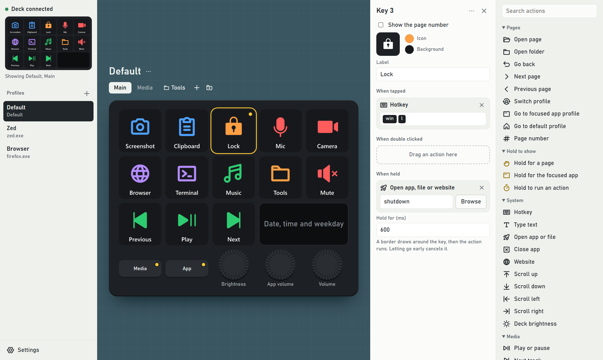
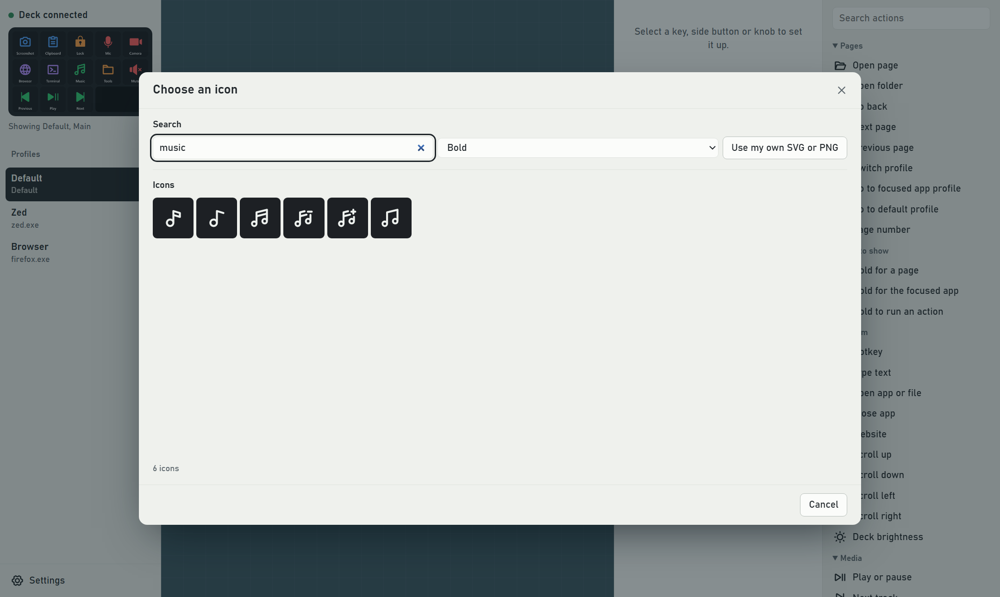
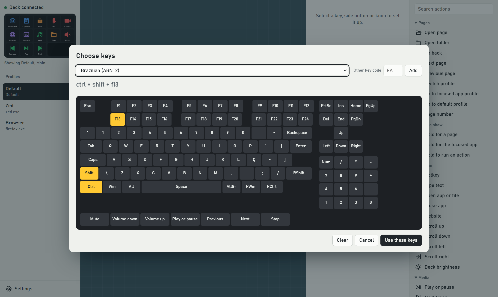

# OpenUlanzi

An open configurator for Ulanzi stream decks, for people who want more than Ulanzi Studio offers. It talks to the deck directly over USB, so it needs no Studio, no plugins and no account.



## Features

- **Profiles that follow your apps.** Match on program, window title or regex. The first match wins, and you pick the default.
- **Pages and folders.** Flip between pages, or open a folder with a fixed Back key that leaves the knobs alone.
- **Three triggers on every key.** Click, double click and hold, with a border that draws on the deck while you hold.
- **Hold to show a page.** Any key or side button can be a modifier, including one that shows the page for the focused app.
- **One-shot switching.** Open a page, press one button, and land back where you started.
- **Plenty of actions.** Hotkeys with any key code, text, apps, websites, media, scrolling, per-app volume, sounds, sequences, toggles and random picks.
- **OBS Studio control.** Record, stream, switch scenes, toggle sources and filters, mix audio and more, through OBS's built-in WebSocket server. The actions appear while OBS is connected.
- **Plugins.** Add actions, live buttons and whole pages with a small program in any language. See [writing a plugin](docs/plugins.md).
- **Over 3,000 built-in icons.** The Phosphor bold and filled sets, or your own SVG and PNG files.
- **Firmware clock faces** on the wide screen, with your own date format.
- **Several decks at once**, each with its own setup.
- **Sleep when you do.** The deck turns off after a set idle time or when the screens turn off.
- **Updates in place.** The app finds new versions and installs the right build for your copy.

| Icon picker | Hotkey picker |
| --- | --- |
|  |  |

## Install

Download the latest build from [Releases](../../releases):

- `OpenUlanzi-<version>-setup.exe` installs the app.
- `OpenUlanzi-<version>-portable.exe` runs without installing. Your settings still live in `%APPDATA%\OpenUlanzi`.

Only one program can talk to the deck, so **quit Ulanzi Studio and turn off its autostart first**. The app keeps running in the tray, and the tray menu can start it at login.

### macOS

- `OpenUlanzi-<version>-macos.dmg` runs on Apple silicon and Intel Macs with macOS 11 or later. Drag OpenUlanzi to Applications.
- The build is not notarised, so the first time, right-click the app and choose **Open**, or run `xattr -dr com.apple.quarantine /Applications/OpenUlanzi.app`.
- Allow OpenUlanzi under **System Settings › Privacy & Security › Accessibility** when it asks. Hotkeys, typed text, scrolling and window titles need it.
- Settings live in `~/Library/Application Support/OpenUlanzi`. The app lives in the menu bar and shows in the Dock only while its window is open.
- Hotkeys use the same names on both systems, so a config moves between them: **Win is ⌘ Command** and **Alt is ⌥ Option** on a Mac. Ctrl is Control, so a Windows `ctrl+c` stays Control-C; use `win+c` for Copy.
- Not on macOS: per-app volume, which macOS has no API for, and the media Stop key. Plugins written for `powershell` run with [PowerShell 7](https://learn.microsoft.com/powershell/scripting/install/installing-powershell-on-macos) (`pwsh`).
- Updates are announced in the app, with a link to download the new version.

## Supported decks

Windows and macOS. Tested on the D200X on Windows. macOS support is new: it finds the deck and runs the editor, but needs more testing with a deck. The D200 and D200H share its protocol but are untested, and USB can't tell the models apart, so pick yours in Settings.

The deck's idle screen comes from its firmware, so OpenUlanzi only controls the deck while it's running. On Windows, hotkeys can't reach windows running as administrator unless OpenUlanzi runs as administrator too.

## Build from source

You need Rust and the [Tauri prerequisites](https://tauri.app/start/prerequisites/).

```
cargo run -p openulanzi-app --release
```

There's also a headless runner: `cargo run --release -- examples/default.toml`.

To build the Mac app and disk image: `cd app && npx @tauri-apps/cli@2 build --bundles app,dmg`.

## License

[MIT](LICENSE). Icons are from [Phosphor](https://phosphoricons.com), also MIT. OpenUlanzi is an independent project, not affiliated with or endorsed by Ulanzi.
